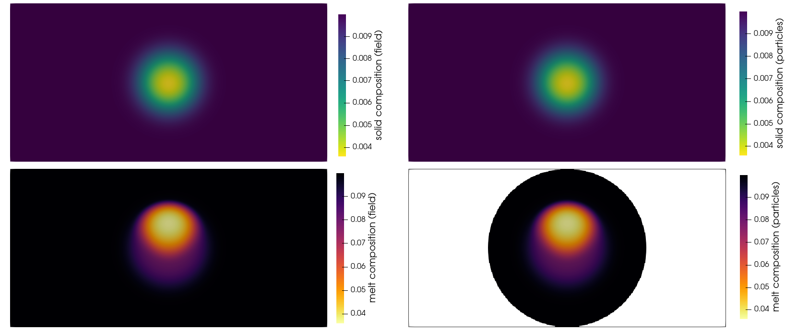
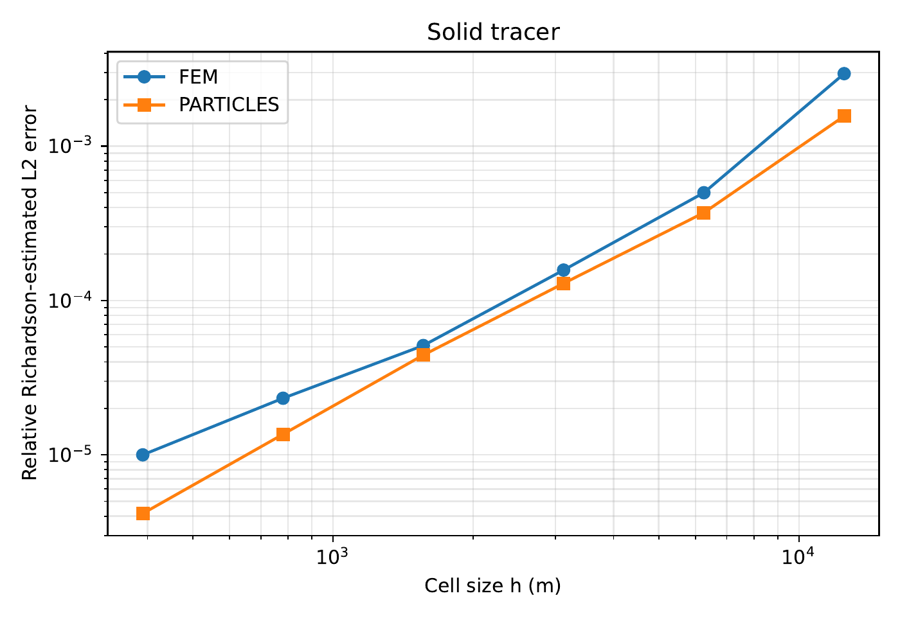
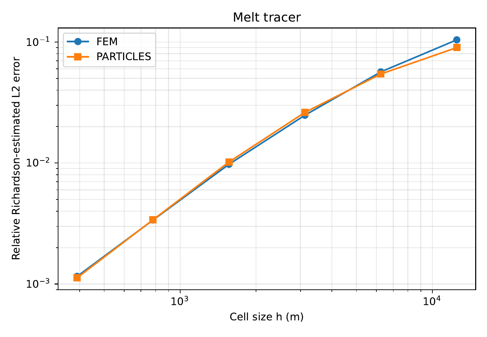
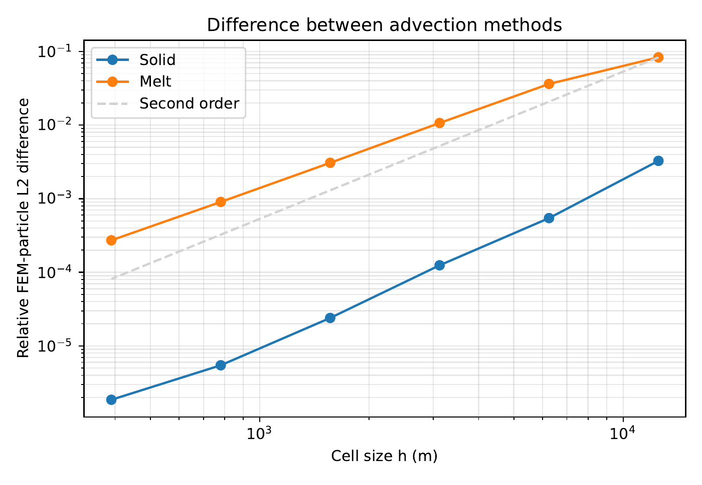

```{tags}
category:benchmark
feature:2d
feature:cartesian
feature:particles
feature:two-phase-flow
```

(sec:benchmarks:melt-particle-transport)=
# Comparison between field and particle methods in a simulation with melt transport

This benchmark compares the transport of solid and melt compositions using
particles and finite element fields. The setup is a
buoyant, initially Gaussian distribution of porosity that rises in a
200 km wide and 100 km high box. In addition, two passive compositions are
transported, one with the solid velocity and one with the melt velocity.
The initial compositions resemble equilibrium partitioning, as one would
expect in application models of magma dynamics. Each of these compositions
is transported using two different methods: on a finite element field
and on particles. This requires two particle systems in the simulation
(one for the solid and one for the melt).
The melt particle system uses the `presence of melt` population model:
only cells where the porosity exceeds a threshold of $10^{-6}$ are filled
with particles (minimum of 16 and maximum of 32 particles per cell).
The solid particles are present throughout the domain.

The simulations run for 80,000 years. The final compositions are shown in
{numref}`fig:melt-particle-transport-solution`.

```{figure-md} fig:melt-particle-transport-solution


Solid (top row) and melt (bottom row) compositions after 80,000 years,
transported using finite element fields (left) and particles (right).
The white region in the bottom-right panel lies outside the region populated
by melt particles.
```

The `run.sh` script can be used to run the benchmark at different resolutions
and compare the results. {numref}`fig:melt-particle-transport-solid` and
{numref}`fig:melt-particle-transport-melt` show the estimated errors.
Since this benchmark does not have an analytical solution, errors are estimated
by Richardson extrapolation using the finest three resolutions, separately
for each transport method. The observed convergence orders range from 1.2 to
1.7, with much smaller relative errors for the solid composition than for
the melt composition. The two transport methods have comparable estimated
errors, particularly for the melt composition. This suggests that errors
shared by both methods, such as errors in the computed solid and melt
velocities, contributing substantially to the total error.

```{figure-md} fig:melt-particle-transport-solid


Relative Richardson-estimated errors for the solid tracer transported on
finite element fields and particles.
The relative $L_2$ norms are weighted by the solid fraction from the finest
solution, with a common normalization for both methods.
```

```{figure-md} fig:melt-particle-transport-melt


Relative Richardson-estimated errors for the melt tracer transported on
finite element fields and particles.
The relative $L_2$ norms are weighted by the melt fraction from the finest
solution, with a common normalization for both methods. The comparison
is restricted to porosities above $10^{-6}$ in that solution.
```

In addition, {numref}`fig:melt-particle-transport-difference` compares the
two methods directly. Their relative difference decreases with refinement
at somewhat less than second order for both compositions.


```{figure-md} fig:melt-particle-transport-difference


Relative differences between the finite element and particle solutions at
each resolution. The dashed line indicates second-order convergence for
comparison.
```


To run the benchmark, compile the accompanying shared library using the supplied
[CMakeLists.txt](https://github.com/geodynamics/aspect/blob/main/benchmarks/melt_particle_transport/CMakeLists.txt) file.
The script [run.sh](https://github.com/geodynamics/aspect/blob/main/benchmarks/melt_particle_transport/run.sh) runs global refinement levels 3–8 using
[melt_particle_transport.prm](https://github.com/geodynamics/aspect/blob/main/benchmarks/melt_particle_transport/melt_particle_transport.prm)
and then calls [analyze_convergence.py](https://github.com/geodynamics/aspect/blob/main/benchmarks/melt_particle_transport/analyze_convergence.py)
to generate these plots.
[generate_points.py](https://github.com/geodynamics/aspect/blob/main/benchmarks/melt_particle_transport/generate_points.py) supplies a common set
of evaluation points for all resolutions. Note that it can take several hours
on a laptop computer to run all refinement levels.
